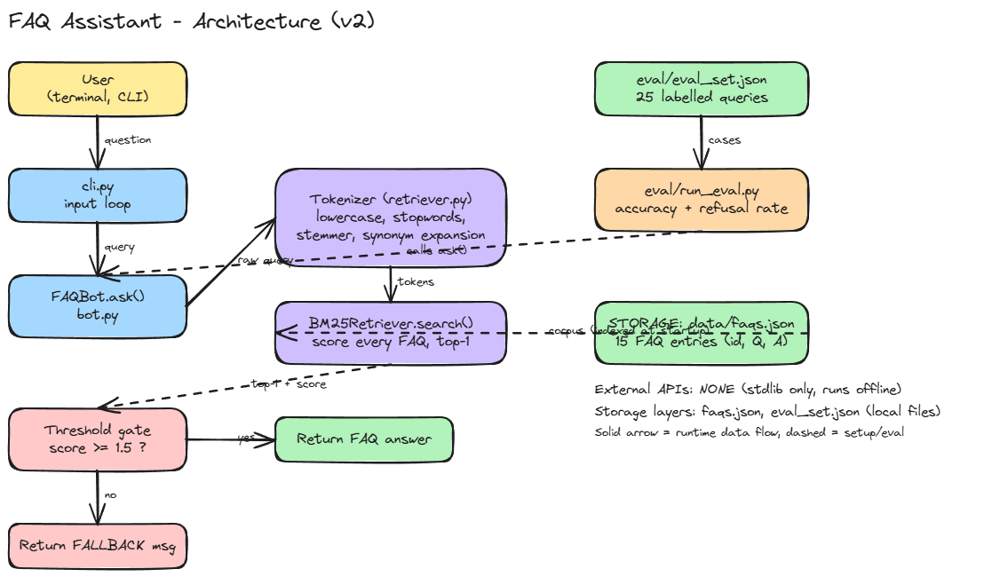

# FAQ Assistant: retrieval-based support bot with an evaluation suite

A small, dependency-free question-answering bot that matches a user's question to the best entry in a FAQ knowledge base, and **refuses to answer** when it is not confident. The focus of this project is not the retrieval itself but the engineering around it: measuring quality, finding failures, and documenting the trade-offs.

## 1. Problem statement

Support teams answer the same questions repeatedly (password reset, refunds, invoices). A naive bot that always returns its "closest" match is worse than no bot: it confidently gives wrong answers to questions it cannot handle (e.g. "how do I cancel my pizza order" returning the subscription-cancellation steps).

This project builds a bot that (a) answers in-scope questions accurately, (b) says "I don't know" for everything else, and (c) ships with an evaluation suite so that both behaviours are measured, not assumed.

## 2. System architecture



The editable diagram is at [`docs/architecture.excalidraw`](docs/architecture.excalidraw) (open it at https://excalidraw.com). Export it as `docs/architecture.png` so it renders here.

Flow: `User -> cli.py -> FAQBot.ask() -> Tokenizer (stopwords, stemmer, synonyms) -> BM25Retriever (scores every FAQ in data/faqs.json) -> threshold gate -> answer or fallback`.

- **External APIs:** none. Runs fully offline.

## 3. Tech stack

| Component | Version / detail |
|---|---|
| Language | Python 3.12.3 (3.10+ required: uses `X \| Y` type syntax) |
| Retrieval | BM25 (Okapi), self-implemented, `k1=1.5`, `b=0.75` |
| Dependencies | none, standard library only (`json`, `re`, `math`, `collections`, `pathlib`) |
| Data | JSON, 15 FAQ entries, 25 labelled eval queries |
| Tooling | Git, GitHub, Excalidraw (diagram), Loom (demo) |

## 4. Local setup

```bash
git clone https://github.com/<divyanshuraj25>/faq-assistant.git
cd faq-assistant
python3 --version        # must be 3.10 or newer
PYTHONPATH=src python3 -m faq_bot.cli
```

Example:

```
> how do I cancel my subscription
[cancel-sub | score=6.69] Go to Account > Billing > Cancel subscription. ...
> tell me a joke
[None | score=0.00] Sorry, I couldn't find an answer to that. Please contact support@example.com.
```

## 5. Running the evaluation suite

```bash
python3 eval/run_eval.py
```

It reports in-scope accuracy and out-of-scope refusal rate, lists every miss, and exits non-zero if there is a failure that is **not** marked `"known_limitation": true` in `eval/eval_set.json` (so it can be used in CI).

Current results (v2):

```
In-scope accuracy   : 15/15 (100%)
Out-of-scope refusal: 7/10 (70%)
  KNOWN 'how do I cancel my pizza order'
  KNOWN 'how do I reset my wifi router'
  KNOWN 'what is the refund policy of amazon'
```

| Version | In-scope accuracy | Out-of-scope refusal |
|---|---|---|
| v1: nearest match, no threshold | 12/15 (80%) | 0/7 (0%) |
| v2: stemmer fix, synonyms, threshold 1.5 | 15/15 (100%) | 7/10 (70%, after adding 3 harder cases) |

See [`docs/case_study.md`](docs/case_study.md) and [`docs/decisions.md`](docs/decisions.md) for the reasoning.

## 6. Known limitations

- **Keyword-based, not semantic.** Out-of-scope questions that share words with an FAQ ("cancel my pizza order") still match, because BM25 only sees word overlap. A semantic embedding model plus a reranker would be the next step.
- **Hand-written synonym list** (`SYNONYMS` in `retriever.py`) does not scale and only covers phrasings I thought of.
- **Tiny eval set** (25 queries) written by the same person who wrote the bot; 100% in-scope accuracy should not be read as real-world accuracy.
- **Threshold (1.5) tuned on the same eval set**, so it is likely slightly optimistic.
- **English only**, single-turn, no conversation memory, returns only the top-1 answer.
